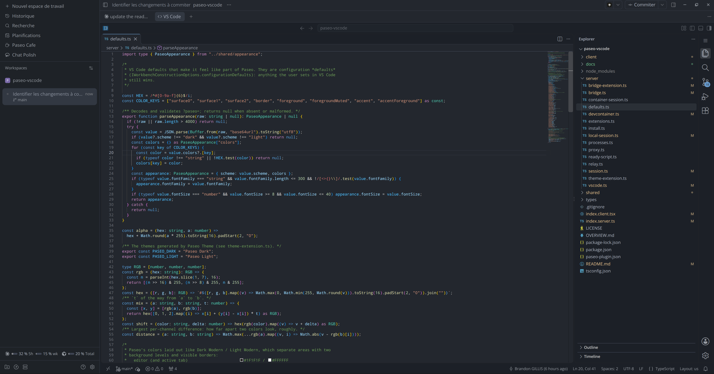

# VS Code for Paseo

Run VS Code in a [Paseo](https://paseo.sh) tab, on your workspace folder. Extensions, the terminal and the debugger work as usual.

Built on [code-server](https://github.com/coder/code-server), with extensions from [Open VSX](https://open-vsx.org). Not affiliated with Microsoft or Coder.



## Features

- Open VS Code from the Command Center or from Paseo's tabs.
- Open files from Paseo's file explorer in VS Code.
- A theme and font matching Paseo.
- Dev containers support.
- Multi-root workspaces through a `.code-workspace` file.

## Requirements

- Paseo 0.15.0 or later, on desktop or web.
- A Linux or macOS daemon host, on the same machine as the Paseo app.
- Docker, for dev containers.

## Install

```bash
paseo plugin add git:BrandonGillis/paseo-vscode
```

On first launch, the plugin asks before downloading code-server (about 220 MB).

## Extensions

Install extensions from VS Code, or list them in **Settings → Plugins → VS Code** to have them installed automatically. A few Microsoft-only extensions, like Pylance, are not on Open VSX.

## Dev containers

If the workspace has a `devcontainer.json`, the plugin asks once whether to open it in the container or locally. Use VS Code's remote indicator (bottom left) or the command palette to switch or rebuild later.

## Data

Everything is stored in `~/.paseo/plugin-data/paseo-vscode`. Delete this folder to reset.

## License

[MIT](LICENSE)
